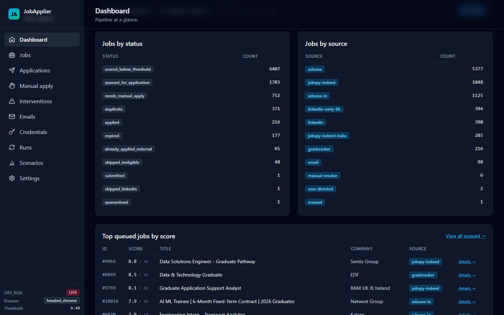
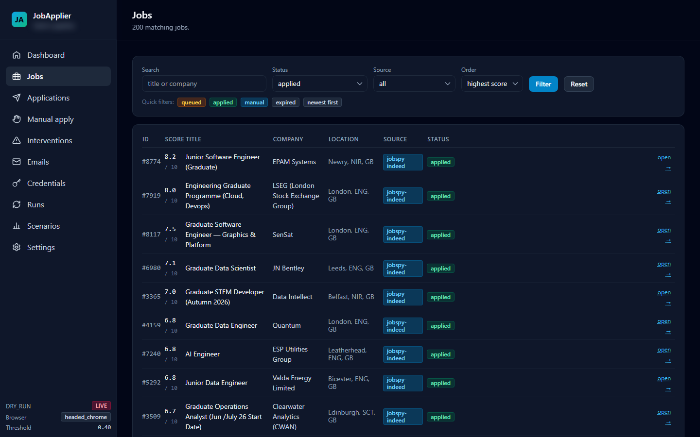
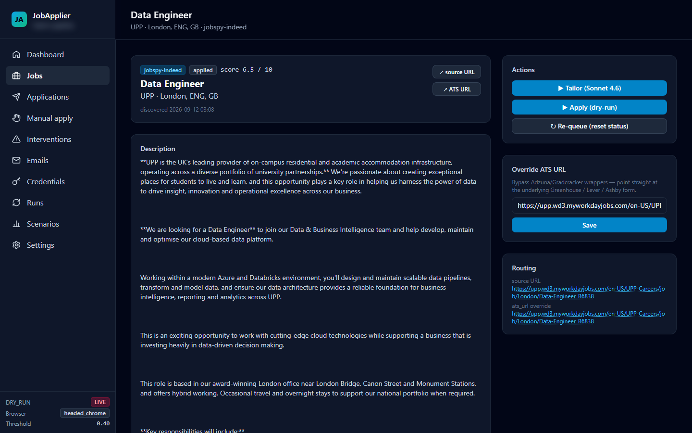
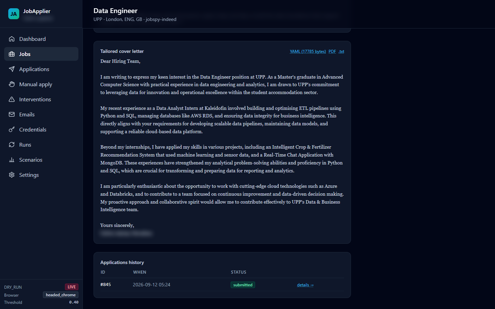
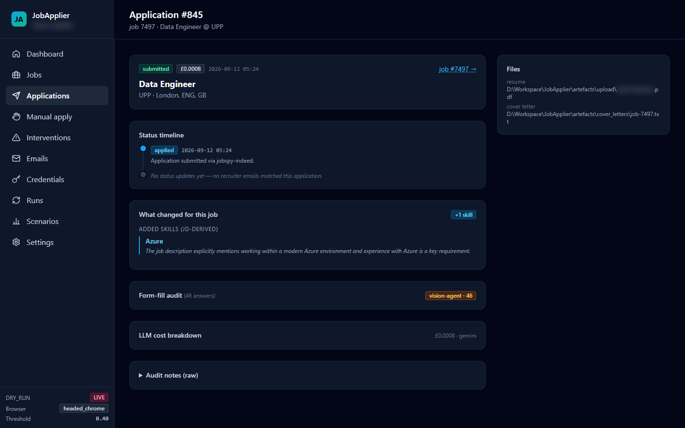
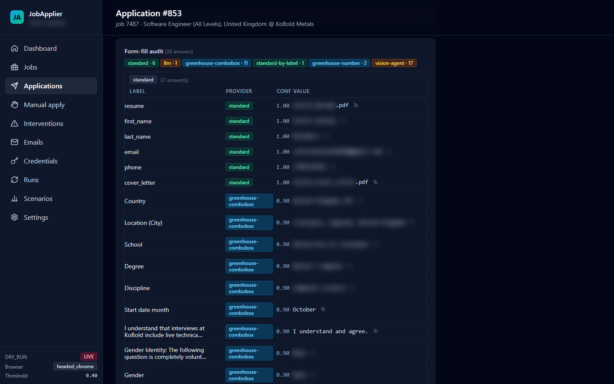
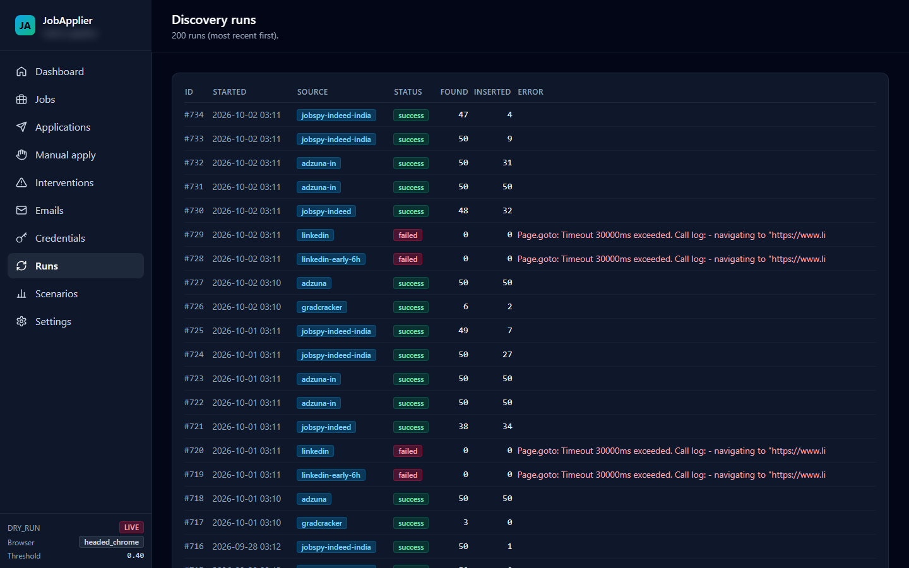

# JobApplier

An end-to-end job application pipeline that finds software and data engineering roles (mainly UK, plus Bangalore and Chennai), ranks them against my CV, prepares a tailored CV and cover letter for each one, and submits the application directly on the employer's own applicant tracking system.

The source code is kept private because it contains personal data and account details. This page describes how the system works.

## Screenshots

All screenshots are from the real local dashboard. Personal details are blurred.


*Dashboard home: discovered jobs by pipeline status and by source, and the highest-scoring roles waiting in the queue.*


*Jobs list, filtered to roles already applied to: match score, employer, location, source and status.*


*Job detail: the scored posting with its routing to the employer's hiring system.*


*The cover letter generated for that job from the master CV.*


*Application detail for the same role: status timeline, the skill the tailoring step added from the job description, and LLM cost.*


*Form-fill audit from another application (a Greenhouse form): each field entered, which component filled it, and its confidence.*


*Discovery runs: per-source results for each scheduled run, including failures.*

## What it does

```
discover ──► deduplicate ──► score ──► tailor ──► apply ──► verify ──► track replies
```

**Discovery.** Collects job postings once or twice a day from five sources: LinkedIn public job search, Indeed, Adzuna (API), Gradcracker and job-alert emails in Gmail. A Glassdoor source is also built but switched off by default. Each scraper uses randomised pacing, runs independently so one failing source never blocks the others, and records its health so repeated failures trigger automatic back-off and an alert.

**Deduplication.** The same job often appears on several sites. Listings are fuzzy-matched on company, title and location, and the copy from the most reliable source is kept.

**Scoring.** Every job description and the master CV are embedded with sentence-transformers and compared by semantic similarity, then adjusted for seniority, graduate-friendliness, posting age and per-employer weighting. Only the top matches are queued.

**Tailoring.** For each queued job, an LLM reorders and rephrases content from a structured YAML master CV to fit the role, then renders the CV and cover letter to PDF with Jinja2 and LaTeX. It never adds experience or skills that are not in the master CV.

**Applying.** Applications go to the employer's real hiring system, not a job board. A handler registry maps each application URL to a dedicated driver for Greenhouse, Lever, Ashby, Workday, Workable, SmartRecruiters, iCIMS, Personio, Phenom, Eightfold and Salesforce / SuccessFactors career sites. Unknown systems fall back to an AI agent that reads screenshots of the page and plans the next form action. All browser work uses Playwright.

**Human in the loop.** When the system is unsure (an unexpected question, low confidence, a verification step) it pauses, takes a screenshot and sends a push notification so I can take over the same browser session. Every new hiring system runs in dry-run mode first, producing the filled form for review without submitting.

**Verification and tracking.** After submitting, the system confirms success from the page URL, page text and confirmation email. A Gmail monitor classifies employer replies (rejection, interview, next steps) with an LLM and updates each application's status.

**Dashboard.** A local web dashboard shows discovered jobs, scores, the queue, every application with its generated documents and answers, items waiting for my input, source health and LLM cost per application. A daily summary is sent by email.

## Engineering

- About 60,000 lines of Python and about 2,400 automated tests (pytest, with external APIs mocked)
- SQLite and SQLAlchemy for jobs, applications, discovery runs and the intervention queue
- Pydantic models for all structured data, loguru logging, ruff formatting
- Interchangeable LLM providers (Anthropic, Gemini, local Ollama) behind one interface, with automatic fallback
- Rate limiting per employer and per hiring system, with cooldowns, and a rolling 24-hour cap of six applications

## Tech stack

Python 3.12, Playwright, SQLAlchemy, SQLite, sentence-transformers, Pydantic, Jinja2, LaTeX, Anthropic API, Gemini API, Ollama, Gmail API, FastAPI, pytest
